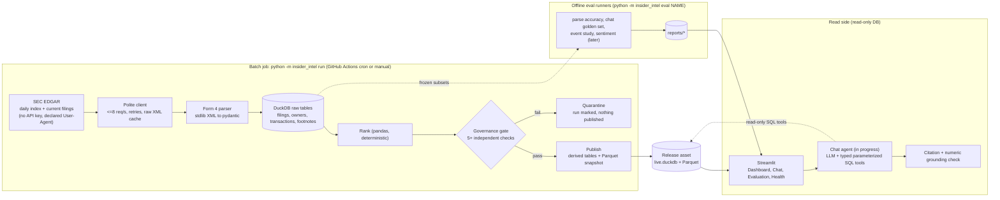

# Architecture (v3)

This describes the v3 target. Items marked *(in progress)* are specified in `REFINEMENT_EXECUTION_PLAN.md` but not yet in the code.

## Components and modules

| Component | Module | Notes |
|---|---|---|
| Config | `config.py` | env / `.env` driven settings |
| EDGAR client, index, parser | `edgar/` (`client.py`, `index.py`, `form4.py`, `models.py`, `quality.py`) | Used by `pipeline/ingest.py` (replaced the earlier sec-api.io path); needs `SEC_USER_AGENT`, see ADR-0002 |
| Pipeline | `pipeline/` (`ingest.py`, `rank.py`, `gate.py`, `run.py`) | Fixed control flow: stages `sec, ranking, gate, publish` |
| Storage | `store/` (`db.py`, `migrations/001..004`) | DuckDB; numbered migrations applied on open, read-only connection for the hosted UI (`build_system(..., read_only=True)` has no pipeline) |
| Chat | `chat/` (`agent.py`, `retrieval.py`, `service.py`, `metrics.py`) | Tool-calling agent (read-only SQL tools, bounded rounds) with numeric grounding; falls back to labelled context stuffing (`degraded.py`) when no model supports tools. ADR-0001 |
| LLM | `llm/client.py` | Free-model fallback chain; paid OpenRouter models rejected |
| Sentiment | `sentiment/classify.py` | Pure classifier, not a pipeline stage |
| Market / event study | `market/` | Prices and event study for the offline evidence stage |
| Eval | `eval/` (`harness.py`, `parse_accuracy.py`, `sec_datasets.py`) | Offline runners writing to `reports/` |
| UI | `app/streamlit_app.py`, `ui/charts.py` | Chart functions are plain code, not an agent |
| Observability | `obs.py` | `timed()` logs one JSON line per stage |
| CLI | `cli.py` | `run`, `check-keys`, `seed-demo` today; see runbook for pending commands |

## Data model

Current tables (created by `store/migrations/`): `filings`, `transactions` (all codes, with a `superseded` flag), `reporting_owners`, `footnotes`,
`ingest_watermark`, `insider_edges`, `top_trades`, `tweets`, `tweet_sentiments`, `sentiment_summary`, `pipeline_runs`, `query_log`, `llm_calls`.
Ranking and chat only read `code IN ('P','S')` rows that are not superseded. The ranking window is `RANK_WINDOW_DAYS` (14), measured on EDGAR acceptance time;
data is refreshed about twice a month (scheduled ingest on the 1st and 15th, freshness check two days later).

Target model (plan B1, B4, B6, P3), not all present yet:

- **Raw** (immutable facts from Form 4 XML): filings (with `accepted_at`), owners, transactions (all codes), footnotes.
- **Derived** (rebuilt each run): rankings (`top_trades`), `pipeline_runs`, `llm_calls` *(in progress)*, `query_log`.
- **Graph**: `insider_edges`, one row per (owner CIK, issuer CIK) with role flags and totals *(in progress)*, see ADR-0004.
- `schema_version` plus numbered migrations (`001_init` .. `004_llm_calls`), applied automatically on a read/write open; `python -m insider_intel migrate` upgrades the live database explicitly.
- `llm_calls`: one row per provider call (latency, tokens, status, notional list-price cost estimate; free-tier models are what is actually used).

## Trust model

1. **No LLM-produced numbers.** Parsing, ranking, statistics and gold answers are deterministic code.
2. **Gate before publish.** Independent checks (ingest reconciliation, notional reconciliation via a separate SQL path,
   per-ticker bounds, ranking arithmetic and order, checksum) must all pass; otherwise the run is quarantined and the
   previous published ranking stays in place.
3. **Grounding.** Chat answers must cite source IDs that exist in the evidence. Numeric grounding (every number in an
   answer matches a tool output) and abstention on empty results are part of the new agent *(in progress)*.
4. **Untrusted text.** Posts and filing text are data, never instructions. The chat tools are read-only and parameterized.
5. **Not investment advice**, and the system does not detect illegal trading.

## Run statuses

`pipeline_runs.status` is one of: `running`, `success`, `partial`, `quarantined` (gate failed, reason in
`error_message`), `failed` (exception, message in `error_message`). The freshness workflow also looks at the latest
status.

## Deliberately not here

- **LightRAG / GraphRAG:** measured as a noisy copy of relations the filings already state. ADR-0004.
- **Learning loop (model-agreement few-shot):** agreement is not correctness. Replaced by offline evals. ADR-0006.
- **Apify / X scraping:** broken, billed when empty, ToS risk. Social source is an open decision. ADR-0005.
- **OpenTelemetry:** spans were never exported; replaced by JSON logging and run/LLM tables (plan C5, P3).
- **Postgres / Prefect / APScheduler:** ADR-0003 and ADR-0007.

ADR index: [adr/README.md](adr/README.md). Operations: [runbook.md](runbook.md).
